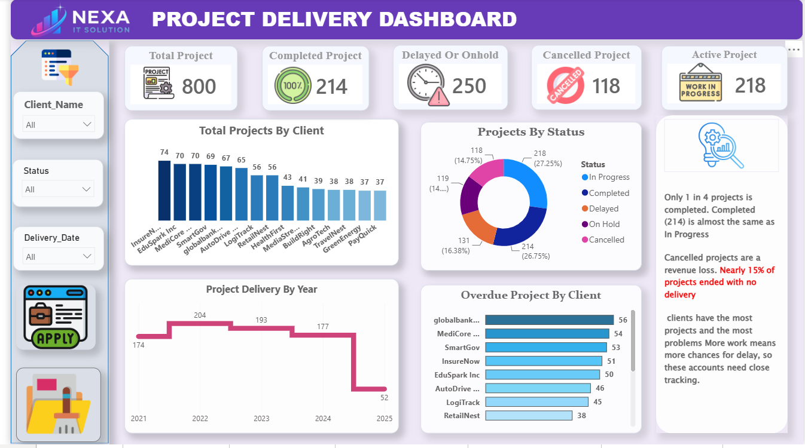

# 📊 Nexa IT Solutions – Business Analytics Project

## 🚀 Project Overview

The Nexa IT Solutions Business Analytics Project is an end-to-end Business Intelligence project developed using Microsoft Power BI.

The project focuses on analyzing business performance across four critical operational areas: Revenue Health, Project Delivery, Employee Performance, and Support Quality.

Using interactive dashboards, KPI tracking, and data visualization, the project transforms business data into meaningful insights to help management identify performance gaps, improve operational efficiency, and make informed business decisions.

---

# 1. 🎯 Business Problem

Organizations often struggle to maintain visibility across different business functions because important operational data is distributed across multiple areas.

Management needs a consolidated view of business performance to understand revenue generation, project delivery efficiency, employee productivity, and customer support quality.

Without proper performance monitoring, businesses may face challenges such as:

- Difficulty identifying high-value clients, profitable regions, and effective contract types.
- Delays in project completion and limited visibility into delivery risks.
- Uneven employee performance and excessive overtime across departments.
- Slow ticket resolution and declining customer satisfaction.

**Business Challenge:** How can management use data analytics to identify operational challenges, monitor business performance, and improve overall organizational efficiency?

---

# 2. 🎯 Business Objectives

The project addresses four major business objectives:

### 1. Revenue Health
Which clients, regions, and contract types generate the most business value?

- Identify top revenue-generating clients.
- Compare revenue performance across regions.
- Evaluate revenue contribution by contract type.
- Monitor renewal, churn, and pending rates.

### 2. Project Delivery
Are projects being completed on time and within budget?

- Monitor completed, active, delayed, and cancelled projects.
- Identify clients with the highest number of overdue projects.
- Analyze project delivery trends over time.
- Identify project delivery risks and areas requiring management attention.

### 3. Employee Performance
Which departments are performing well, and where is overtime highest?

- Compare average employee performance across departments.
- Identify departments with the highest overtime hours.
- Analyze employee attendance and performance ratings.
- Understand the relationship between overtime and employee performance.

### 4. Support Quality
How quickly are tickets resolved, and are clients satisfied?

- Analyze average ticket resolution time.
- Compare resolution performance across support teams.
- Evaluate resolution time across ticket priority levels.
- Monitor customer satisfaction and identify service improvement opportunities.

---

# 3. 🔬 Business Hypotheses

The following hypotheses are proposed for investigation using the available business data.

| Business Area | Hypothesis |
|---|---|
| Revenue Health | A small group of high-value clients contributes a significant share of total revenue. |
| Revenue Health | Differences in contract types may influence revenue contribution and client retention. |
| Project Delivery | Clients with a higher number of projects may experience more delivery challenges. |
| Project Delivery | Delayed and overdue projects may indicate gaps in project planning and execution. |
| Employee Performance | Departments with higher overtime may not necessarily achieve higher performance ratings. |
| Employee Performance | Employee attendance may be associated with differences in performance. |
| Support Quality | Ticket priority may influence average resolution time. |
| Support Quality | Similar resolution times across teams may indicate opportunities to improve the overall support process. |

*Note: These are analytical hypotheses to investigate, not proven causal relationships.*

---

# 4. 📈 Dashboard Analysis & Key Insights

## 4.1 Client Revenue Dashboard

**Business Focus:** Revenue generation, client retention, regional performance, and contract distribution.

### Key Performance Indicators (KPIs)

- Total Clients: 15
- Total Revenue: ₹297.73K
- Renewal Rate: 33%
- Churn Rate: 17.83%
- Pending Rate: 32%

### Key Insights

- West region generates the highest revenue among the displayed regions.
- The top five clients contribute approximately 43% of total revenue.
- The renewal rate of 33% highlights an opportunity to strengthen client retention.
- Pending contracts require further attention to reduce potential revenue risks.

### Recommendations

- Develop targeted retention strategies for existing clients.
- Focus on maintaining relationships with high-revenue clients.
- Investigate the revenue contribution and profitability of different contract types.
- Follow up on pending contracts to improve conversion and renewal performance.

### Dashboard Preview

---

## 4.2 Employee Performance Dashboard

**Business Focus:** Employee productivity, department performance, overtime, and attendance.

### Key Performance Indicators (KPIs)

- Total Employees: 1.5K
- Average Overtime Hours: 19.7
- Average Performance Rating: 3.13
- Average Attendance: 77%

### Key Insights

- Engineering records the highest average overtime hours at 21.41.
- Sales and Product departments also report relatively high overtime.
- HR records the lowest average overtime hours at 16.50.
- HR has the highest average performance rating of 3.77.
- Higher overtime does not necessarily indicate better employee performance.

### Recommendations

- Review workload distribution in departments with high overtime.
- Investigate the reasons behind excessive overtime in Engineering and Product.
- Identify effective working practices in high-performing departments.
- Monitor employee attendance and performance together.
- Consider workload optimization and employee well-being initiatives.

### Dashboard Preview

---

## 4.3 Project Delivery Dashboard

**Business Focus:** Project completion, delivery performance, overdue projects, and client-wise workload.

### Key Performance Indicators (KPIs)

- Total Projects: 800
- Completed Projects: 214
- Delayed or On-Hold Projects: 250
- Cancelled Projects: 118
- Active Projects: 218

### Key Insights

- Only 214 out of 800 projects are completed, representing approximately 26.75%.
- Delayed and on-hold projects account for approximately 31.25% of total projects.
- Cancelled projects account for approximately 14.75% of total projects.
- Clients with a higher project volume also require closer monitoring of overdue projects.
- The project status distribution highlights the need for stronger delivery monitoring.

### Recommendations

- Investigate the major reasons behind project delays and cancellations.
- Prioritize overdue projects and establish regular progress reviews.
- Monitor high-workload clients more closely.
- Improve project planning, resource allocation, and delivery tracking.
- Introduce planned-versus-actual budget monitoring to identify cost overruns.

### Dashboard Preview

---

## 4.4 Support Performance Dashboard

**Business Focus:** Ticket resolution efficiency, team performance, ticket priorities, and customer satisfaction.

### Key Performance Indicators (KPIs)

- Total Tickets: 3K
- Total Clients: 15
- Average Resolution Time: 14.76
- Average Satisfaction Score: 2.85

### Key Insights

- Average ticket resolution time is relatively similar across all four support teams.
- Team performance does not show a major difference in average resolution time.
- Critical-priority tickets have the lowest average resolution time among the displayed priority categories.
- The average customer satisfaction score of 2.85 highlights an opportunity to improve support quality.
- Customer satisfaction requires attention alongside ticket resolution efficiency.

### Recommendations

- Investigate the reasons behind low customer satisfaction.
- Collect customer feedback to identify recurring service issues.
- Review support workflows to improve resolution efficiency.
- Monitor team performance using resolution time and customer satisfaction together.
- Introduce service quality improvement targets.

### Dashboard Preview

---

# 5. 🛠️ Tools & Technologies

| Tool / Technology | Purpose |
|---|---|
| Microsoft Power BI | Interactive dashboard development |
| Power Query | Data cleaning and transformation |
| DAX | KPI calculations and analytical measures |
| Microsoft Excel | Data storage and source data management |
| Data Analytics | Business performance analysis |
| Data Visualization | Presenting business insights |

---

# 6. 💻 Skills Demonstrated

- Data Cleaning and Transformation
- Data Modeling
- DAX Calculations
- KPI Development
- Interactive Dashboard Development
- Business Intelligence
- Data Visualization
- Business Performance Analysis
- Hypothesis Development
- Analytical Thinking
- Business Recommendations
- Data-Driven Decision Making

---

# 7. 📁 Project Files

| File Name | Description |
|---|---|
| Client_Revenue.png | Client Revenue Dashboard preview |
| Employee_Performance.png | Employee Performance Dashboard preview |
| Project_Delivery.png | Project Delivery Dashboard preview |
| Support_Ticket.png | Support Performance Dashboard preview |
| IT Services Analytics Dataset (1).xlsx | Business analytics source dataset |
| Nexa IT Solution Project Upgrad.pbix | Power BI project report |

---

# 8. 💡 Recommendations for Management

Based on the dashboard analysis, the following actions are recommended:

1. **Improve Revenue Retention:** Strengthen relationships with high-value clients and investigate opportunities to improve contract renewals.
2. **Optimize Employee Workload:** Review overtime patterns and balance workloads across departments.
3. **Strengthen Project Management:** Prioritize delayed projects, investigate cancellations, and introduce budget tracking.
4. **Improve Customer Experience:** Investigate low satisfaction scores and identify opportunities to improve support quality.
5. **Establish Continuous Monitoring:** Use regular KPI reviews to track progress and identify emerging business risks.

---

# 9. 📊 Business Impact & Insights

The project provides management with a consolidated view of organizational performance across four important business functions.

### Revenue Health
Helps management identify high-value clients, understand regional revenue contribution, and recognize opportunities to improve client retention.

### Project Delivery
Highlights project completion challenges, delayed projects, and clients requiring closer monitoring, supporting better project management and resource allocation.

### Employee Performance
Provides visibility into departmental performance, overtime patterns, and attendance, helping management identify workload imbalances and improve workforce efficiency.

### Support Quality
Highlights ticket resolution performance and customer satisfaction, helping management identify service improvement opportunities and strengthen customer relationships.

### Overall Business Impact

- Better visibility into organizational performance.
- Improved identification of operational risks.
- More informed resource allocation.
- Stronger client retention and revenue monitoring.
- Improved project delivery oversight.
- Better employee workload management.
- Opportunities to enhance customer satisfaction.

**Final Outcome:** This project demonstrates how Business Intelligence and data analytics can transform operational data into actionable insights, helping organizations make smarter, evidence-based business decisions.

---

# 🏁 Conclusion

The Nexa IT Solutions Business Analytics Project demonstrates the practical application of Microsoft Power BI in solving business problems across revenue management, employee performance, project delivery, and customer support.

By combining interactive dashboards, KPI tracking, business hypotheses, and actionable recommendations, this project showcases how data analytics can support strategic planning and operational improvement.

---
**Project Name:** Nexa IT Solutions – Business Analytics

**Project Category:** Business Intelligence & Data Analytics

**Primary Tool:** Microsoft Power BI

**Technologies:** Power BI | Power Query | DAX | Excel

**Project Status:** Completed
