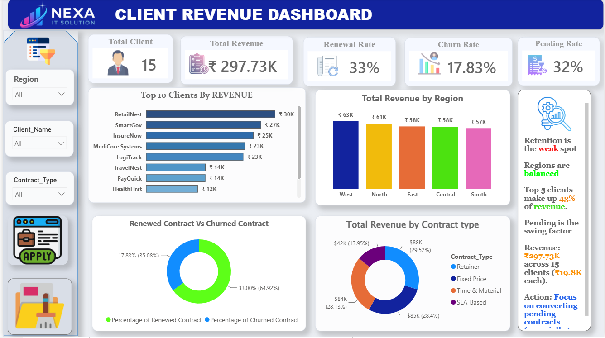
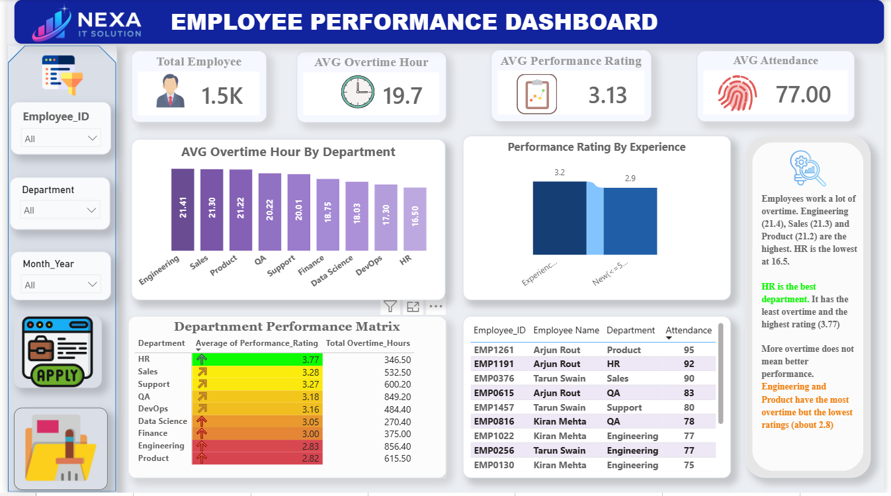
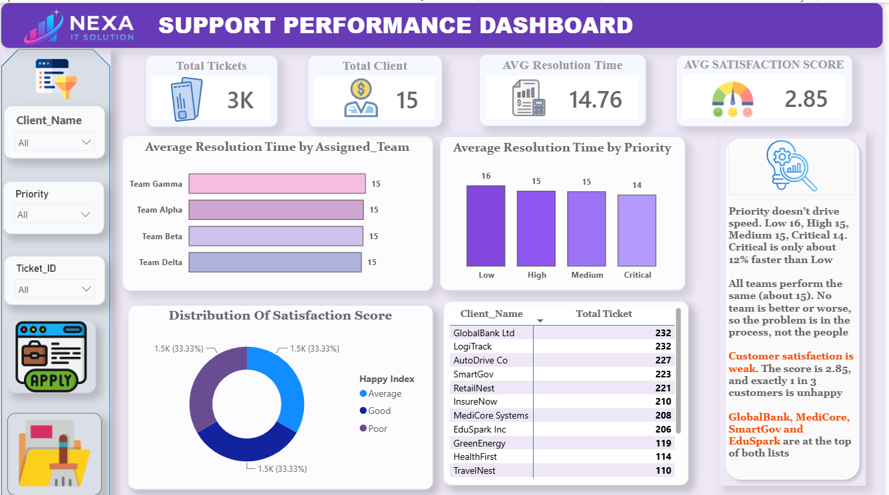

# 📊 Nexa IT Solutions – Business Analytics Project

## 🚀 Project Overview

The Nexa IT Solutions Business Analytics Project is an end-to-end Business Intelligence project developed using Microsoft Power BI.

This project analyzes business performance across four major operational areas: Client Revenue, Employee Performance, Project Delivery, and Customer Support.

The objective is to transform business data into meaningful insights through interactive dashboards, KPI tracking, and data visualization to support informed business decision-making.

---

## 🎯 Business Objectives

- Analyze client revenue, retention, and contract performance.
- Evaluate employee productivity, attendance, and overtime.
- Monitor project completion, delays, and delivery performance.
- Analyze customer support efficiency and satisfaction.

---

# 📈 Dashboard Analysis

## 1. Client Revenue Dashboard

**Objective:** Analyze revenue performance, client retention, regional revenue distribution, and contract status.

### Key Performance Indicators

- Total Clients: 15
- Total Revenue: ₹297.73K
- Renewal Rate: 33%
- Churn Rate: 17.83%
- Pending Rate: 32%

### Key Business Insights

- West region generates the highest revenue.
- The displayed renewal rate highlights an opportunity to improve client retention.
- The top five clients contribute approximately 43% of total revenue, according to the dashboard commentary.
- Pending contracts require further attention.

### Dashboard Preview


---

## 2. Employee Performance Dashboard

**Objective:** Evaluate employee performance, department productivity, overtime hours, and attendance.

### Key Performance Indicators

- Total Employees: 1.5K
- Average Overtime Hours: 19.7
- Average Performance Rating: 3.13
- Average Attendance: 77%

### Key Business Insights

- Engineering records the highest average overtime hours.
- HR records the lowest average overtime hours.
- HR has the highest average performance rating among departments.
- Employee productivity should be evaluated alongside attendance and overtime.

### Dashboard Preview



---

## 3. Project Delivery Dashboard

**Objective:** Monitor project execution, completion, delays, cancellations, and client-wise project distribution.

### Key Performance Indicators

- Total Projects: 800
- Completed Projects: 214
- Delayed or On-Hold Projects: 250
- Cancelled Projects: 118
- Active Projects: 218

### Key Business Insights

- Approximately 26.75% of projects are completed.
- Approximately 31.25% of projects are delayed or on hold.
- Approximately 15% of projects are cancelled.
- Project delays require closer monitoring and management attention.

### Dashboard Preview


---

## 4. Support Performance Dashboard

**Objective:** Analyze support ticket resolution, team performance, ticket priorities, and customer satisfaction.

### Key Performance Indicators

- Total Tickets: 3K
- Total Clients: 15
- Average Resolution Time: 14.76
- Average Satisfaction Score: 2.85

### Key Business Insights

- Resolution times are relatively similar across support teams.
- Critical-priority tickets have the lowest average resolution time among the displayed priority categories.
- The average satisfaction score highlights an opportunity to improve customer experience.
- Support team performance can be monitored to identify areas for improvement.

### Dashboard Preview



---

# 🛠️ Tools & Technologies

| Tool | Purpose |
|---|---|
| Microsoft Power BI | Dashboard development |
| Power Query | Data cleaning and transformation |
| DAX | KPI calculations and measures |
| Data Analytics | Business performance analysis |
| Data Visualization | Presenting business insights |

---

# 📊 Skills Demonstrated

- Data Cleaning and Transformation
- Data Modeling
- DAX Calculations
- KPI Development
- Interactive Dashboard Development
- Business Intelligence
- Data Visualization
- Business Performance Analysis
- Analytical Thinking
- Insight Generation

---

# 💡 Business Value

This project demonstrates how Power BI can help organizations:

- Monitor business revenue and client retention.
- Evaluate employee performance and productivity.
- Identify project delivery challenges.
- Improve customer support operations.
- Track important business KPIs.
- Make data-driven business decisions.

---

# 📁 Project Structure

```text
Nexa-IT-Solutions-Business-Analytics/
│
├── README.md
│
├── Screenshots/
│   ├── 01_Client_Revenue.png
│   ├── 02_Employee_Performance.png
│   ├── 03_Project_Delivery.png
│   └── 04_Support_Performance.png
│
├── Dashboards/
│   ├── Nexa_Client_Revenue.pbix
│   ├── Nexa_Employee_Performance.pbix
│   ├── Nexa_Project_Delivery.pbix
│   └── Nexa_Support_Performance.pbix
│
└── Dataset/
    └── Source_Data.csv
```
*Note: Include only the files and folders that you have actually uploaded. Share datasets only when permitted.*
---

# 📝 Conclusion

The Nexa IT Solutions Business Analytics Project provides a consolidated view of business performance across four important operational areas.

By using Power BI, this project transforms business data into interactive dashboards and actionable insights that can support management decisions, improve operational efficiency, and identify opportunities for business growth.

---

**Project Name:** Nexa IT Solutions – Business Analytics

**Project Category:** Business Intelligence & Data Analytics

**Primary Tool:** Microsoft Power BI

**Technologies:** Power BI | Power Query | DAX

**Project Status:** Completed
